# Field Measure Quick Start

Photograph a job, put feet-and-inch dimensions on the photo with your finger, and export a PDF for
the job folder. Field Measure runs on your Surface with no signal, no account and no sign-in. Everything
it makes is saved in a folder on the Surface.

**App link:** https://llevaachingada.github.io/FieldMeasure/
(If your shop made its own copy, use that link instead.)

## 1. Install it (2 minutes, Wi-Fi once)

1. On the Surface, open **Microsoft Edge** and go to the app link.
2. Tap the **Install** icon at the right end of the address bar, then **Install**.
   No icon? Tap **…** → **More tools** → **Apps** → **Install Field Measure**.
3. Field Measure opens in its own window. From now on, open it from the **Start menu** or the
   taskbar, not from Edge.
4. Check it works offline: turn on **airplane mode**, close the app, open it again from the Start
   menu. It opens. Turn airplane mode back off.

## 2. First time you open it

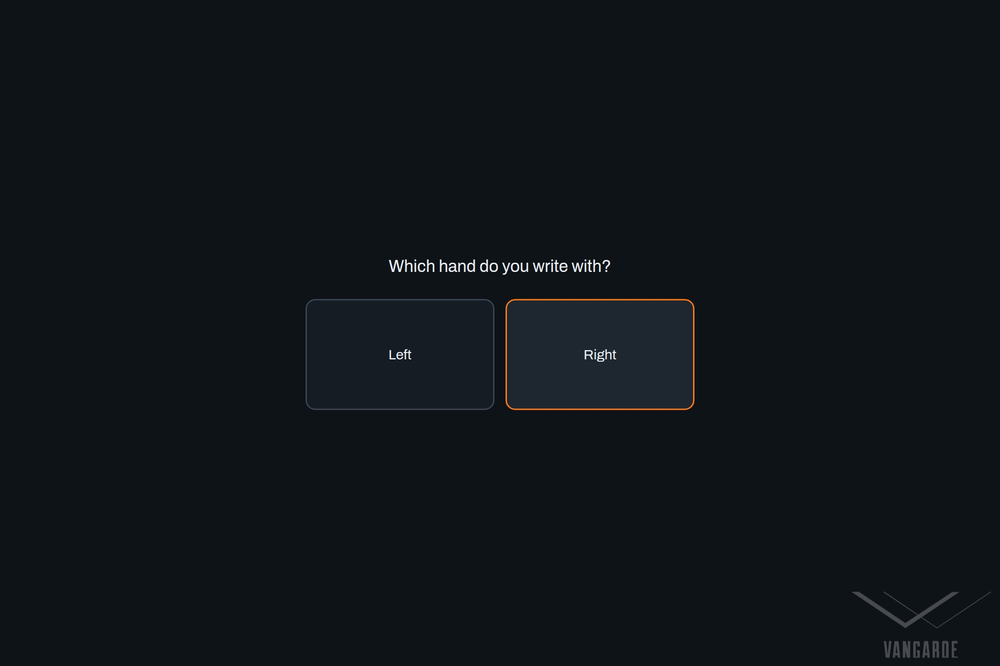

1. **Which hand do you write with?** Tap **Right** or **Left**. The tool bar moves to the side your
   hand doesn't cover.

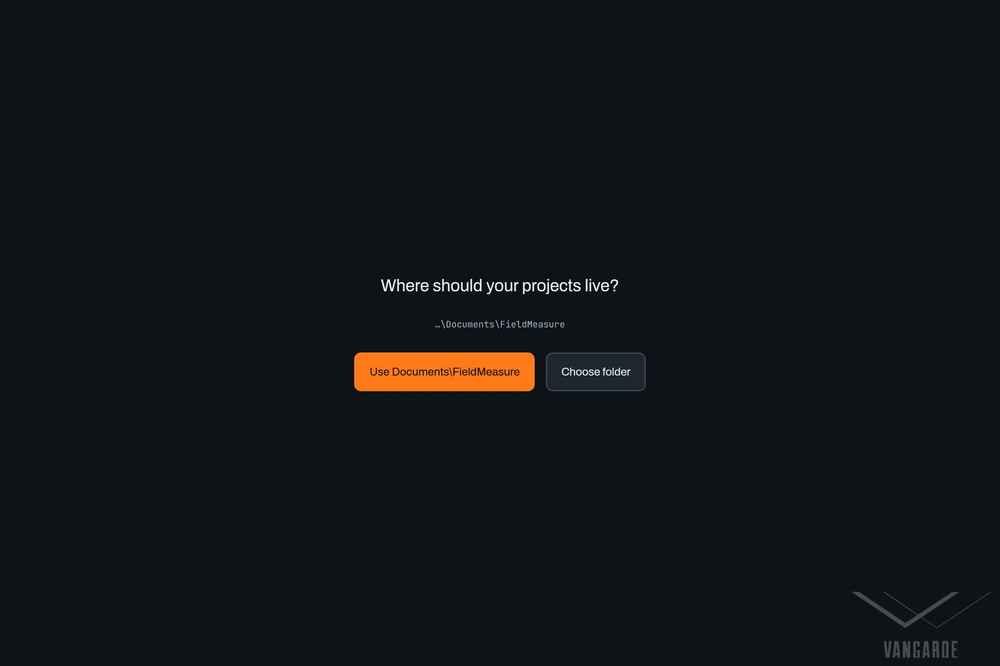

2. **Where should your projects live?** Tap **Use Documents\FieldMeasure**. When Windows or Edge
   asks about folder access, choose **Allow on every visit**.

## 3. Take a photo

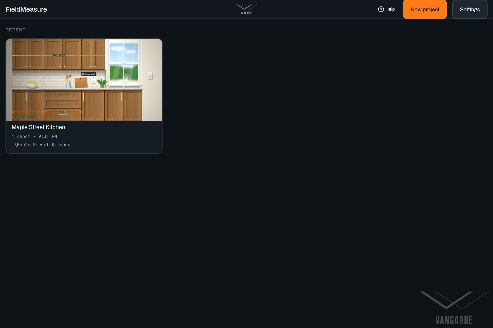

1. On **Home**, tap **New project**, type a name (the job or address) and tap **Create project**.

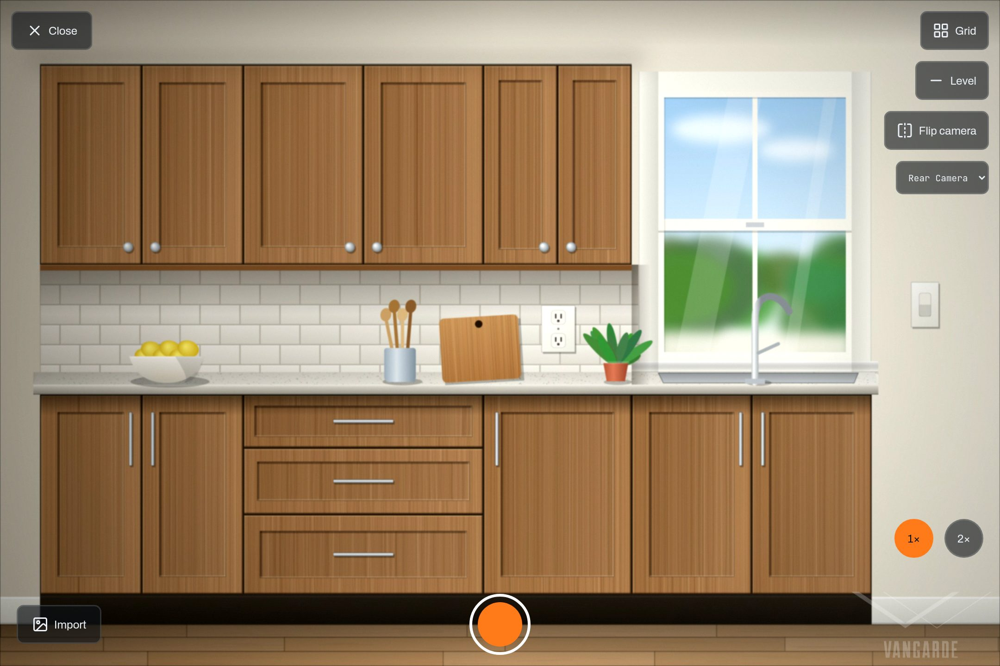

2. The camera opens. Line up the shot and tap the round **shutter** button. The **1×** and **2×**
   chips zoom. To use a photo already on the Surface, tap **Import**.

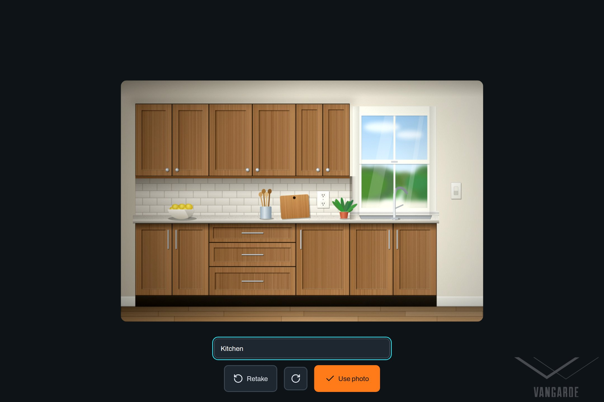

3. Type a **Room name** if you like (it is printed on the export), then tap **Use photo**. Tap
   **Retake** to try again.

## 4. Add dimensions

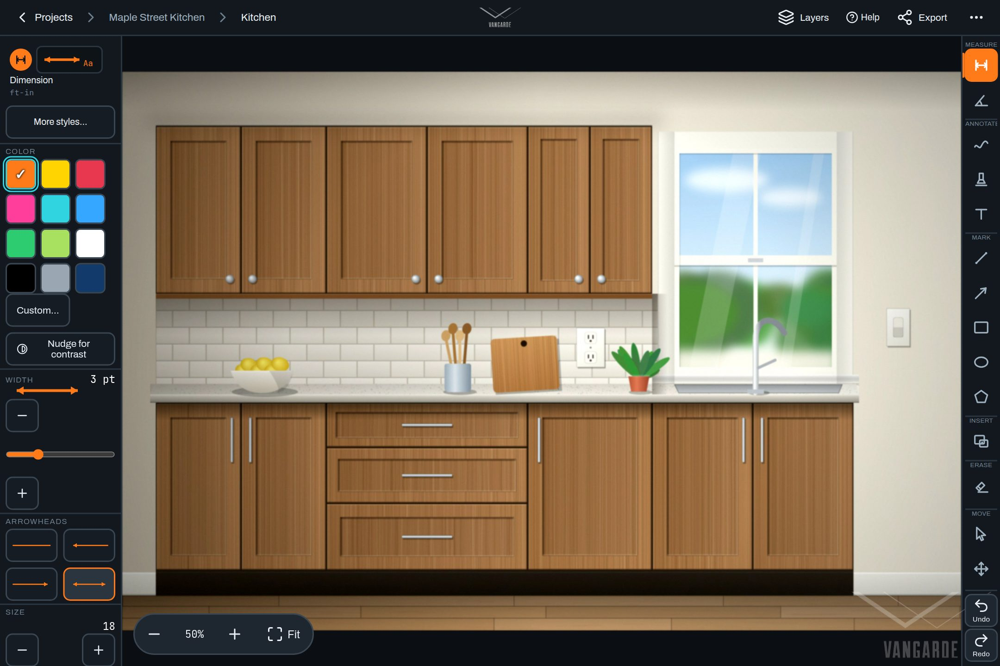

1. In the tool bar at the side of the screen, tap **Dimension** (at the top, under **Measure**).
2. Tap where the measurement starts, then tap where it ends. The keypad opens.

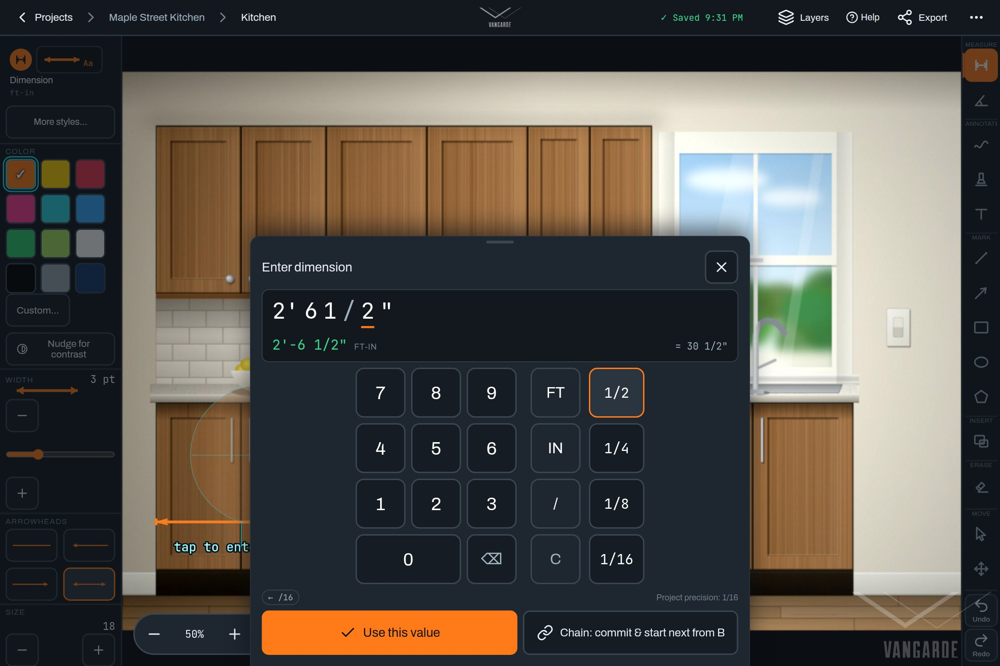

3. Type the size and tap the check mark. For 2'-6 1/2" tap **2**, **FT**, **6**, **IN**, **1**,
   **/**, **2**. For inches only, skip the **FT** part.

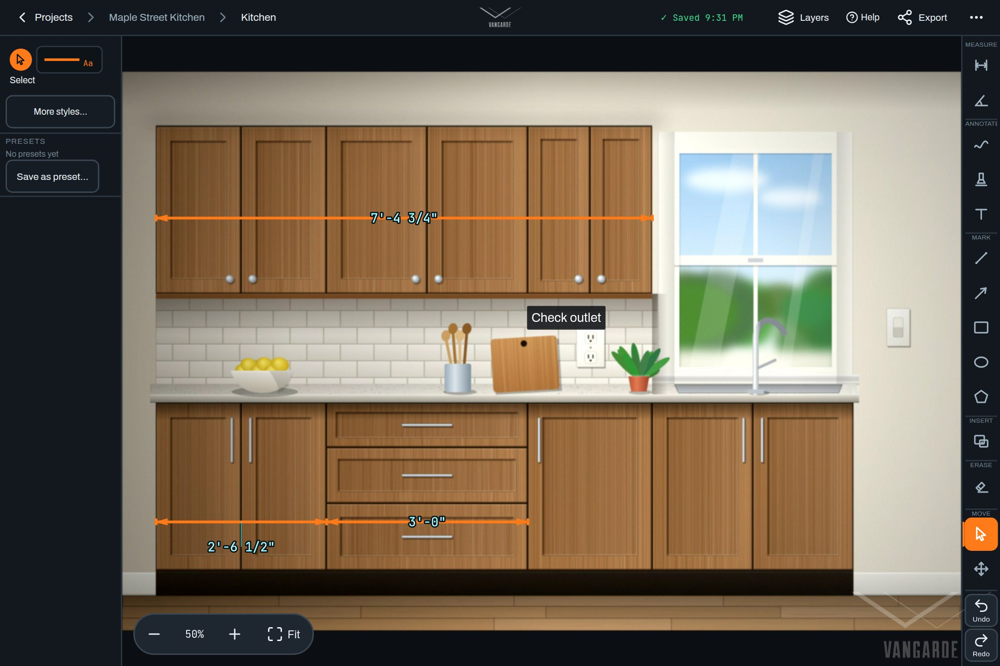

4. To move the numbers off the line, tap **Select**, tap the dimension, then drag its numbers.
5. To fix an end, tap **Select**, tap the dimension, then drag one of its round end grips. The
   magnifier shows exactly where you are, and the end snaps to other marks (a green ring).
6. **Undo** and **Redo** are at the bottom of the tool bar.

**Tips**

- Pinch with two fingers to zoom. Drag with two fingers to move around the photo.
- Place points with one fingertip, and keep your palm off the glass while you tap.
- Everything saves automatically. Watch for **Saved** at the top of the screen.

## 5. Mark up the photo

- **Annotate**: freehand drawing, highlighter and **Text** notes (tap **Text**, then tap the photo).
- **Mark**: lines, arrows, rectangles, ellipses and shapes.
- Colour, line width and arrowheads are in the style panel beside the photo. **More styles…**
  opens the rest.
- **Image inset** (under **Insert**) puts a close-up photo inside this one.
- **Erase**: tap **Erase**, then tap a mark. **Undo** brings it back.
- **Layers** (top bar) lists every mark, so you can hide or lock one.

## 6. Export and share

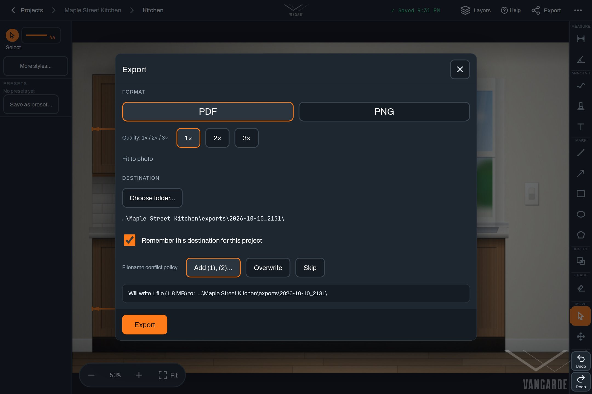

1. Tap **Export** (top bar). Choose the sheets, **PDF** or image, and where to save, then tap
   **Export** at the bottom.

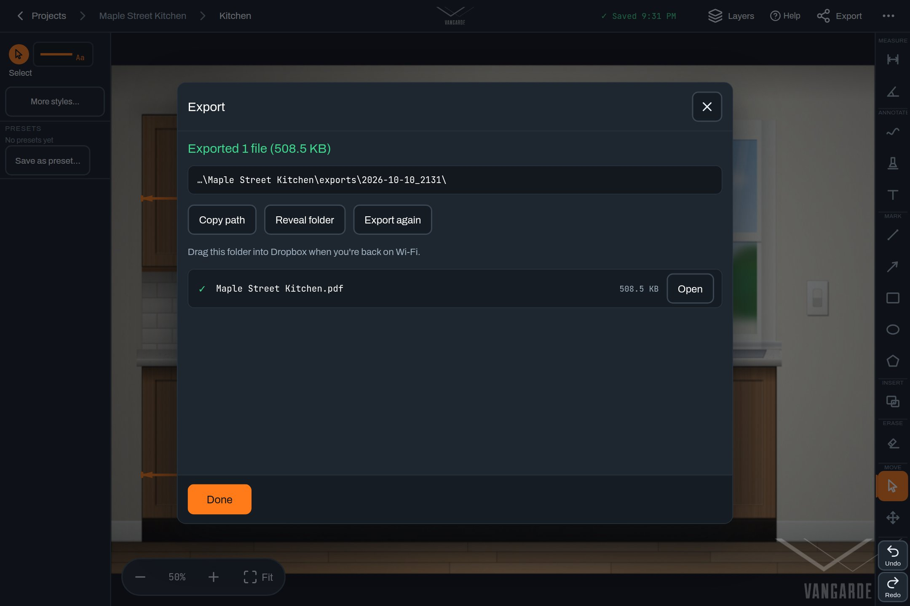

2. When it's done, tap **Copy path** and paste it into File Explorer, or tap **Open** to view the
   PDF.
3. To share, drag the project folder or the PDF into **Dropbox**, or attach the PDF to an email.
   The dimensions, the date and time, the room name and the VANGARDE mark are on the page.

## 7. Projects and sheets

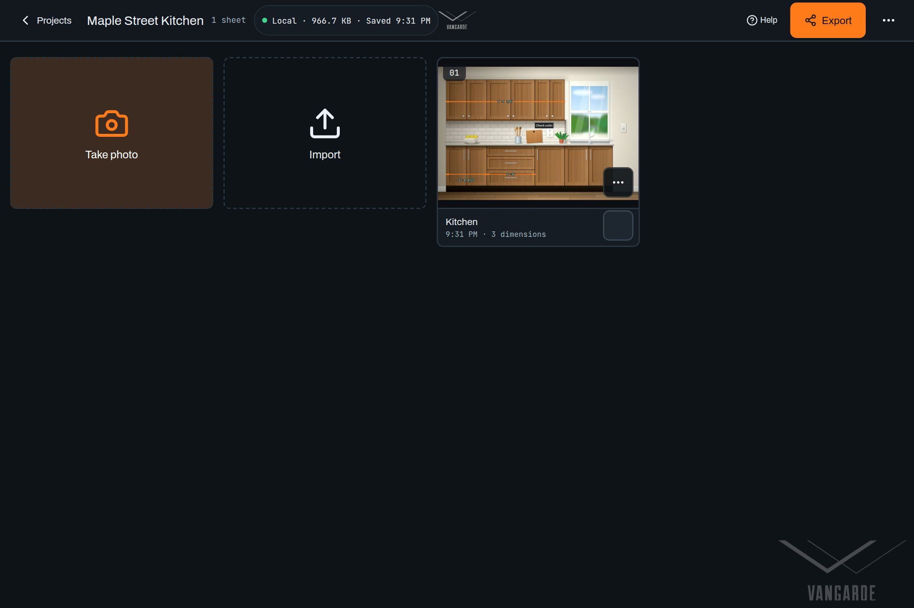

- Each photo is a **sheet**. Tap **Projects** (top left in the editor) to see all of a job's sheets.
- **Take photo** adds another sheet. Tap **⋯** on a sheet to rename, duplicate, replace its photo
  or delete it.
- To reorder, press and hold a sheet, then drag it.
- Deleted sheets wait in **Trash…** (the **⋯** menu at the top of the project page) for 14 days.

## 8. If something goes wrong

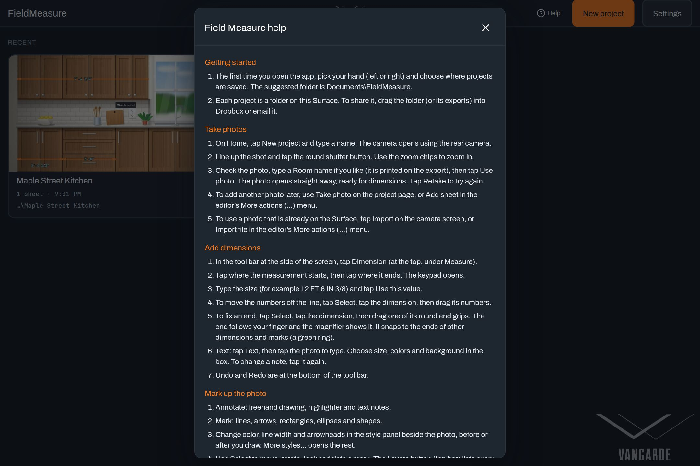

Tap **Help** at the top of any screen for the full guide. Common fixes:

| Problem | What to do |
|---|---|
| **Folder permission expired** on Home | Tap **Re-authorize**, then **Allow on every visit**. |
| **Update ready** banner | Tap **Reload** when you're between photos. Your work is saved first. |
| Camera won't start | Close other apps that use the camera. Check Windows **Settings > Privacy & security > Camera**. |
| The first-run questions came back and projects are missing | The app was opened from a different link. Pick the same folder; every project is still there. |
| A project can't be read | Tap **Retry**. If another Surface saved it with a newer version, update this app first. |
| Something looks wrong in a measurement or export | Don't delete anything. Take a screenshot and tell whoever looks after the app. |
